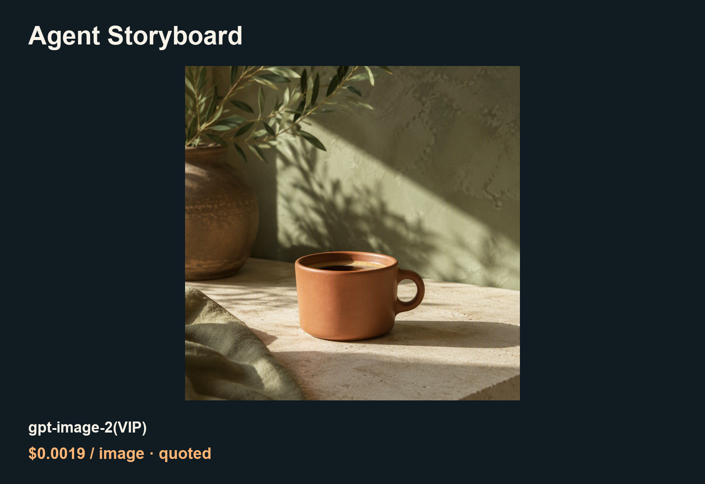

# Lower-cost media API guide for Agent Storyboard

<!-- TOAPIS-OWNER-INVITE -->
[Sign up / use ToAPIs](https://toapis.com/login?aff=BEWR) · [Guide price table](PRICING.md)
<!-- /TOAPIS-OWNER-INVITE -->

<!-- TOAPIS-SELECTED-PRICES-20261022 -->
## Selected model quotes · 2026-10-22

| Model / conditions | Current reference quote | Billing basis |
|---|---:|---|
| `gpt-image-2-vip` · low / 1K / one image | **$0.0019/image** | Default-group quote for the queried key, not final settlement |
| `seedance-2-5` · 4s / 480p / MP4 / first-frame image, no video or audio input | **$10/1M total tokens** | Token-metered, not a fixed per-second tariff |

Checked with read-only international `/v1/pricing` queries. Account groups, inputs and settings can differ; use your account quote and task settlement. Dated cases and historical fees below retain their original dates.
<!-- /TOAPIS-SELECTED-PRICES-20261022 -->


[English](README.md) · [中文](README_zh-CN.md)

Plan shots and attach generated pictures and clips to a local storyboard.

An independently maintained ToAPIs community guide, not an endorsed app edition. [Original project](https://github.com/Yuuhann1999/agent-storyboard); [pinned source 9924c97f](https://github.com/Yuuhann1999/agent-storyboard/tree/9924c97f04e1b76dabebe8fa376a5a224285aa90).

<!-- TOAPIS-SUPPORT-20261022 -->
## Third-party maintenance and support

This optional ToAPIs workflow is independently maintained by ToAPIs and is separate from the upstream Agent Storyboard project. It is not an upstream built-in provider or an official app edition.

For setup, usage, API errors or ToAPIs billing questions, contact the ToAPIs team through [this guide's Issues](https://github.com/ToAPIs-2025/lower-cost-agent-storyboard-toapis/issues) or [yami@toapis.com](mailto:yami@toapis.com). The upstream project does not maintain this workflow or handle its API billing support.

<!-- /TOAPIS-SUPPORT-20261022 -->

## Examples



[MP4 demo](assets/seedance-2-5-f534fcedf3.mp4) · [Video parameters and settled charge](PRICING.md)

## Case prices (2026-10-21)

| Model / settings | Rate | Case fee / source |
|---|---:|---|
| gpt-image-2(VIP) · low / 1K | $0.0019/image | Final image charge unavailable; same-key quote |
| seedance-2-5 · 480p / requested 4s | $0.096114/s in this case | $0.3883 settled; 4.04s file |

<sub>seedance-2-5: same-key catalog $10/1M total tokens. Per-second figure above is measured from this settled clip, not a fixed future rate.</sub>

[Model landing page and current price](https://toapis.com/login?aff=BEWR) · [PRICING.md](PRICING.md)

## Validation scope

The pinned local app accepted actual PNG and MP4 files through task claim/complete, persisted ready state and served matching bytes. Browser UI and a native ToAPIs model provider are not certified.

## Generate and reuse

Use Python 3 and a private local `TOAPIS_API_KEY`; origin `https://toapis.com` without `/v1`. Query the price first; add `--live` explicitly to submit. Every run matches `/v1/pricing` for the same key and reads confirmed billing from submit/task responses.

```bash
python unified_client.py --model gpt-image-2-vip --prompt-file prompts/image.txt
python unified_client.py --model gpt-image-2-vip --prompt-file prompts/image.txt --max-usd 0.10 --run-id coffee-001 --live
```

The same inputs and run ID resume the original saved task. An uncertain submit stops rather than retrying. A new run ID is a new paid job.

[Project-specific integration](INTEGRATION.md) · [Sanitized case data](cases.json) · [Original prompts](prompts/)
