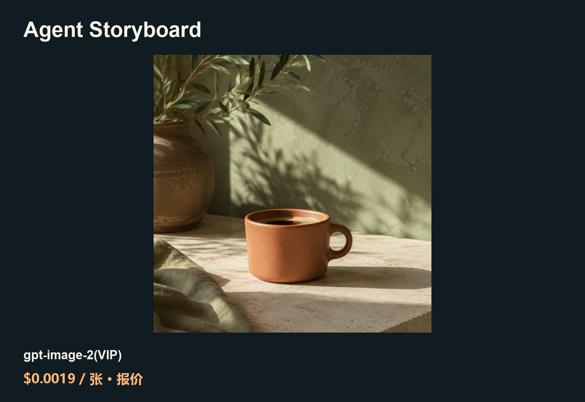

# 更低成本的 Agent Storyboard API 素材方案

[English](README.md) · [中文](README_zh-CN.md)

在本地分镜表中安排镜头，回填生成的图片和视频。

这是 ToAPIs 独立维护的社区教程，不是上游官方版本。原项目：[Yuuhann1999/agent-storyboard](https://github.com/Yuuhann1999/agent-storyboard)；固定源码 [9924c97f](https://github.com/Yuuhann1999/agent-storyboard/tree/9924c97f04e1b76dabebe8fa376a5a224285aa90)。

## 演示



[MP4 demo](assets/seedance-2-5-f534fcedf3.mp4) · [Video parameters and settled charge](PRICING.md)

## 费用（2026-10-21）

| 模型／条件 | 单价 | 本案例费用／来源 |
|---|---:|---|
| gpt-image-2(VIP) · low / 1K | $0.0019/image | 实扣待回执；此数为同 Key 配置报价 |
| seedance-2-5 · 480p / requested 4s | $0.096114/s in this case | $0.3883 settled; 4.04s file |

<sub>seedance-2-5: same-key catalog $10/1M total tokens. Per-second figure above is measured from this settled clip, not a fixed future rate.</sub>

[模型落地页与价格](https://go2v.toapis.com/1021_as_gh) · [PRICING.md](PRICING.md)

## 验证范围

固定源码本地应用经任务 claim/complete 接受真实 PNG 与 MP4，持久化 ready 状态且下载字节一致；尚未验证浏览器 UI，也不是新建原生 ToAPIs Provider。

## 调用与复用

Python 3，仅在本机私有环境配置 `TOAPIS_API_KEY`，Base 为 `https://toapis.com`（不带 `/v1`）。先查询报价，再显式添加 `--live` 提交。每次调用均核对相同 Key 的 `/v1/pricing`；通过生成响应和任务查询读取已确认 billing。

```bash
python unified_client.py --model gpt-image-2-vip --prompt-file prompts/image.txt
python unified_client.py --model gpt-image-2-vip --prompt-file prompts/image.txt --max-usd 0.10 --run-id coffee-001 --live
```

相同输入与 run-id 恢复原任务；丢失提交响应时停止并核对，不自动重发。更换 run-id 是一次新的付费任务。

[Project-specific integration](INTEGRATION.md) · [Sanitized case data](cases.json) · [Original prompts](prompts/)
